# Sword Slasher RPG: Shadow Link's Awakening

[](https://polyformproject.org/licenses/noncommercial/1.0.0/)
[](#technical-specifications--schemas)
[](#system-architecture)

**Sword Slasher RPG: Shadow Link's Awakening** (`Sword Slasher 2`) is a top-down 2.5D action-RPG engine and multi-runtime simulation suite driven by decoupled BEJSON 105 data matrices. All tile maps, spatial sector coordinates, underworld supertiles, actor stats, physics parameters, items, audio synthesizer profiles, and event scripts live in pure BEJSON 105 tables executed across three parity engines: the TypeScript React Client (`src/`), the Vanilla JavaScript Parity Engine (`Engines/JS/`), and the Single-File Experimental HTML Compiler (`Engines/Experimental/`).

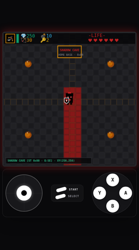
*_Figure 1: Shadow Cave Home Base (Underworld Supertile 0x00) with In-Canvas HUD and Spatial Telemetry_*

---

## Table of Contents

- [Prerequisites & Setup](#prerequisites--setup)
- [Installation & Quick Start](#installation--quick-start)
- [Core Features & Usage](#core-features--usage)
- [Visual Interface Tour](#visual-interface-tour)
- [Spatial World & Dual-Grid Map Architecture](#spatial-world--dual-grid-map-architecture)
- [System Architecture](#system-architecture)
- [Technical Specifications & Schemas](#technical-specifications--schemas)
- [CLI & Compiler Reference](#cli--compiler-reference)
- [Testing & Verification](#testing--verification)
- [License & Attribution](#license--attribution)

---

## Prerequisites & Setup

- **Node.js**: `v20.0+` (or `v22+` / `v26+`) with `npm` and `tsx` for the React 19 TypeScript application and Express server (`server.ts`).
- **Python**: `Python 3.10+` for the standalone single-file compiler (`Engines/Experimental/Compiler/Compile.py`), the Flask server (`Engines/PY/`), and the Playwright verification suite (`dev/test_engines_playwright.py`).
- **Environment Configuration**:
  - Optional: Configure `GEMINI_API_KEY` in `.env` (or toggle external keys in the in-app System Menu) if using the `/api/gemini/advisor` endpoint in `server.ts`.

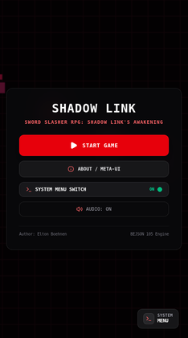
*_Figure 2: React Intro Start Screen with Animated BEJSON Matrix Backdrop and System Menu Switch_*

---

## Installation & Quick Start

### 1. Run the TypeScript React Application

```bash
# Install dependencies
npm install

# Start the development server (Express + Vite on port 3000)
npm run dev

# Build the production bundle to dist/
npm run build
```

### 2. Run the Vanilla JavaScript Parity Engine

Host the repository root with any static HTTP server and open `Engines/JS/index.html`:

```bash
python3 -m http.server 8765
# Navigate to http://127.0.0.1:8765/Engines/JS/index.html
```

### 3. Compile & Run the Standalone Single-File HTML Game

Compile all 20 raw BEJSON 105 datasets from `game_data/raw/` directly into a self-contained offline HTML file (`Engines/Experimental/Compiled/standalone-game.html`):

```bash
python3 Engines/Experimental/Compiler/Compile.py --compile
```

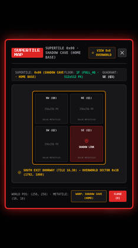
*_Figure 3: Context-Sensitive X-Button Spatial Map Indoors — Underworld Supertile 0x00 4-Quadrant View_*

---

## Core Features & Usage

### 1. Decoupled BEJSON 105 Simulation Runtime
- The engine ingests 22 BEJSON 105 tables (`levels`, `portals`, `biomes`, `actors`, `actor_stats`, `items`, `objects`, `object_rules`, `events`, `sprites`, `tiles`, `audio`, and runtime stores) from `game_data/raw/` (and `public/data/`).
- Every table lookup resolves column indices via cached field maps (`lib_bejson_Gaming_core_adapter.ts` / `.js`).

### 2. Spatial World & Context-Sensitive `X`-Button Map
- **Home Base (`Shadow Cave`, Supertile `0x00`)**: Campaign starting point (`512 × 512 px`, `32 × 32` metatiles) subdivided into four `256 × 256 px` quadrants (`NW (Q0)`, `NE (Q1)`, `SW (Q2)`, `SE (Q3)`).
- **Overworld `8 × 8` Sector Grid (`overworld_grid`)**: `4096 × 4096 px` world canvas partitioned into 64 sectors (`0x00`–`0x3F`, `512 × 512 px` each). Stepping through the south doorway of `Shadow Cave` transitions to Overworld Sector `0x1B` (`Col 3, Row 3`, $X = 1792, Y = 1808$).
- **Context-Sensitive `X`-Button Spatial Map**:
  - Pressing `X` (or tapping the `X` gamepad button) indoors opens the **Underworld Supertile `0x00` Map**, highlighting Shadow Link's active quadrant and the south exit doorway.
  - Pressing `X` outdoors automatically opens the **`8 × 8` Overworld Field Map**, supporting **Mode 7 Perspective Tilt** and **2D Ortho** projection with live player sector markers and `1:4` Mode 7 coordinates.

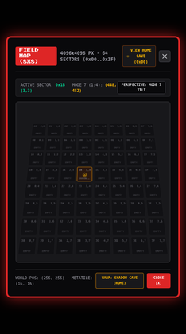
*_Figure 4: Overworld 8x8 Field Map (64 Sectors, 0x00..0x3F) with Mode 7 Affine Perspective Tilt_*

### 3. Combat, Equipment Layering & 10-Slot Ancilla Physics
- **Directional Equipment Layering**: 2.5D Y-sorted depth queue with dynamic shield and sword ordering (`IN_FRONT_BODY` vs. `BEHIND_BODY`) and idle sheathing (hold `B` while standing still for 120 frames).
- **Sword Slash & Whirling Blade (`B` / `J` / `Z`)**: 14-frame sweep arc with 3 angle variations, vector knockback impulse decay, and 360-degree charged spin attack.
- **10-Slot Ancilla Item Engine (`Y` / `I`)**: Parallel projectile slot allocator (`lib_bejson_Gaming_ancilla_item_engine.js`) powering the Shadow Boomerang (`shadow_boomerang`) and Dark Bow (`dark_bow`).

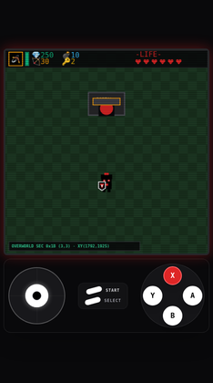
*_Figure 5: Exiting Shadow Cave South Doorway onto Overworld Sector 0x1B (Col 3, Row 3)_*

---

## Visual Interface Tour

### React Client (`src/`)

| View | Capture | Description |
| :--- | :---: | :--- |
| **Overworld `8 × 8` Map (2D Ortho)** | 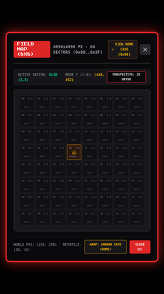 | Orthographic 64-sector grid view with visited sector tracking and home base indicator at `0x1B`. |
| **Live Outdoor Sector `0x1B` Ping** | 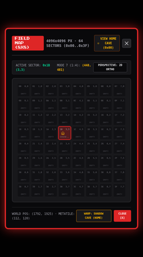 | Pressing `X` outdoors auto-selects the `8 × 8` Field Map and highlights Shadow Link's live position in Sector `0x1B (3,3)`. |
| **Sword Slash Arc (`B` Button)** | 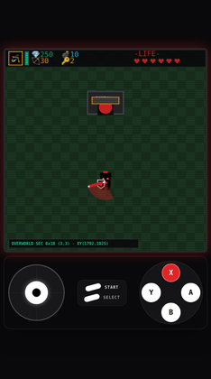 | 14-frame crimson crescent blade sweep with AABB hit detection and knockback vector calculation. |
| **Boomerang Flight (`Y` Button)** | 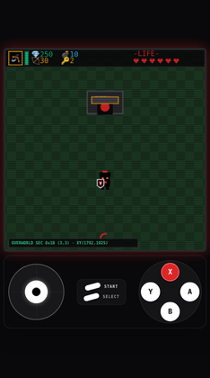 | Outward-and-return boomerang trajectory with prop destruction and item pickup retrieval. |
| **System & Debug Settings (`SELECT`)** | 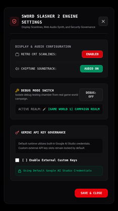 | `SELECT` menu controlling CRT scanlines and the isolated Debug Domain switch. |
| **Sub-Screen Inventory (`START`)** | 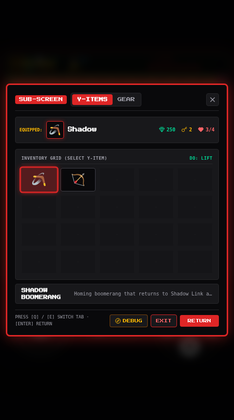 | `START` equipment sub-screen for selecting active `Y`-button items and inspecting player status. |

---

### Vanilla JS Parity Engine (`Engines/JS/`) & Experimental Single-File Engine (`Engines/Experimental/`)

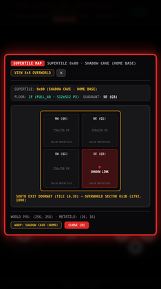
*_Figure 6: Vanilla JS Parity Engine — Context-Sensitive X-Button Underworld Supertile 0x00 Map_*

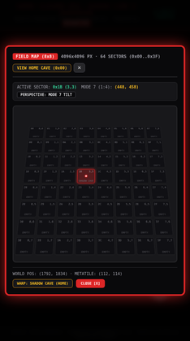
*_Figure 7: Vanilla JS Parity Engine — X-Button 8x8 Overworld Field Map with Mode 7 Perspective Tilt_*

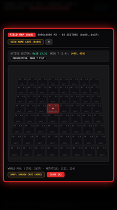
*_Figure 8: Experimental Single-File HTML Engine — X-Button 8x8 Overworld Field Map_*

---

## Spatial World & Dual-Grid Map Architecture

The spatial subsystem (`lib_bejson_Gaming_spatial_world_engine.ts` / `.js`) enforces power-of-two pixel dimensions across every tier so coordinate conversions execute via bit-shift arithmetic:

| Spatial Tier | Base Composition | Pixel Dimensions | Bit Shift (from px) | Total Capacity |
| :--- | :--- | :--- | :--- | :--- |
| **Sub-Tile (Atomic)** | `1 × 1` micro-unit | `8 × 8 px` | `>> 3` | `512 × 512` (`262,144` in Overworld) |
| **Gameplay Metatile** | `2 × 2` sub-tiles | `16 × 16 px` | `>> 4` | `256 × 256` (`65,536` in Overworld) |
| **Structural Megatile** | `2 × 2` metatiles | `32 × 32 px` | `>> 5` | `128 × 128` (`16,384` in Overworld) |
| **Indoor Quadrant** | `16 × 16` metatiles | `256 × 256 px` | `>> 8` | `4` per Underworld Supertile |
| **Sector / Supertile** | `32 × 32` metatiles | `512 × 512 px` | `>> 9` | `64` Overworld Sectors / `256` Supertiles |
| **Full Overworld Canvas** | `256 × 256` metatiles | `4096 × 4096 px` | `>> 12` | `8 × 8` Sectors (`0x00`–`0x3F`) |

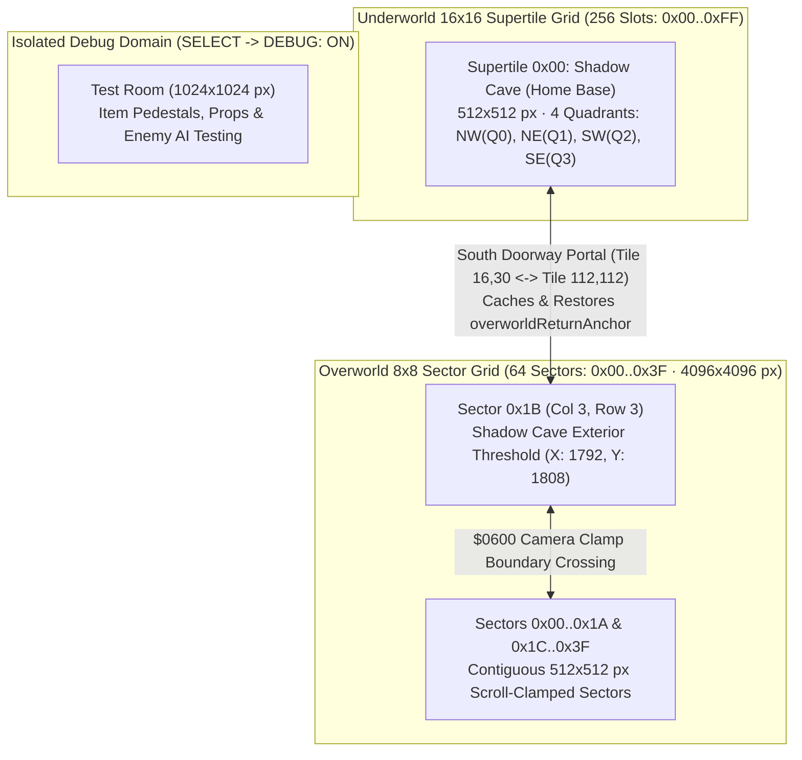

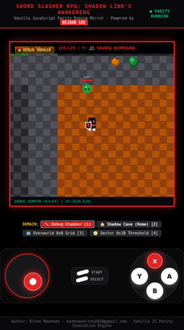
*_Figure 9: 360-Degree Virtual Analog Joystick and Action Cluster with Active Red State Feedback_*

---

## System Architecture

```text
Shadow_Link_Awakeing/
├── bejson_project.json               # Release & package version tracker (PKG161)
├── index.html                        # React 19 application entry point
├── package.json                      # Node dependencies & build scripts
├── server.ts                         # Express + Vite server & /api/gemini/advisor proxy
├── dev/
│   ├── change-log.md                 # Per-package release history
│   ├── test_engines_playwright.py    # Headless Chromium Playwright E2E test suite
│   └── world_map_architecture_plan.md# Spatial World & Dual-Grid technical specification
├── Engines/
│   ├── JS/                           # Vanilla JavaScript Parity Engine (index.html, main.js)
│   ├── PY/                           # Python/Flask Parity Server (app.py, config.json)
│   └── Experimental/                 # Single-File HTML Compiler & Output
│       ├── Compiler/Compile.py
│       └── Compiled/standalone-game.html
├── game_data/raw/                    # Source-of-truth BEJSON 105 tables (20 datasets)
├── public/data/                      # Web client BEJSON 105 dataset mirror
└── src/
    ├── App.tsx                       # Main React view state & modal controller
    ├── components/
    │   ├── GameViewport.tsx          # 60 FPS canvas loop, 3-layer BG1/BG2/BG3 & HUD
    │   ├── GamepadDeck.tsx           # Touch analog joystick & diamond action buttons
    │   ├── WorldMapOverlay.tsx       # Context-sensitive X-button 8x8 / Supertile map
    │   ├── SubScreenOverlay.tsx      # START inventory & equipment selector
    │   └── SettingsModal.tsx         # SELECT settings & Debug Mode switch
    ├── engine/
    │   ├── bejsonEngine.ts           # BEJSON 105 loader & entity query engine
    │   ├── physicsEngine.ts          # 2D AABB collision & vector knockback decay
    │   └── soundEngine.ts            # Web Audio API procedural synthesizer
    └── lib/
        ├── lib_bejson_Gaming_core_adapter.ts
        ├── lib_bejson_Gaming_spatial_world_engine.ts
        ├── lib_bejson_Gaming_engine.ts
        └── lib_js/                   # Shared JavaScript gaming & core modules
```


*_Figure 10: Experimental Single-File Engine — Sword Slash Arc and Item Pedestals_*

---

## Technical Specifications & Schemas

All data files in `game_data/raw/` and `public/data/` conform to the **BEJSON 105** specification (`Format_Version: "105"` or `"105a"`). Below is the canonical structure from `game_data/raw/portals/portals.105.bejson` linking `Shadow Cave` (`fa8b5962-afc8-439c-966a-470241c6d3f0`) and the `8 × 8` Overworld Sector Grid (`fa8b5962-afc8-439c-966a-470241c6d3f2`):

```json
{
  "Format": "BEJSON",
  "Format_Version": "105",
  "Format_Creator": "Elton Boehnen",
  "Schema_Version": "2.0.0-105",
  "Parent_Hierarchy": "../manifest/105a.mfdb.bejson",
  "Write_Owner_Module": "lib_bejson_Gaming_level_loader.js",
  "Primary_Key_Field": "port_uuid",
  "Type_Discriminator_Field": "port_record_type",
  "Domain_Type_Field": "port_transition_trigger_type",
  "Records_Type": ["WorldPortal"],
  "Fields": [
    { "name": "port_uuid", "type": "string", "required": true, "primary_key": true },
    { "name": "port_record_type", "type": "string", "required": true, "enum": ["WorldPortal"] },
    { "name": "port_transition_trigger_type", "type": "string", "required": true, "enum": ["STEP_ON_TILE", "INTERACT_DOOR", "BOSS_DEFEAT_UNLOCK", "ONE_WAY_DROP"] },
    { "name": "port_slug_code", "type": "string", "required": true },
    { "name": "port_source_lvl_uuid_fk", "type": "string", "required": true },
    { "name": "port_source_tile_coord_x_index", "type": "integer", "required": true },
    { "name": "port_source_tile_coord_y_index", "type": "integer", "required": true },
    { "name": "port_target_lvl_uuid_fk", "type": "string", "required": true },
    { "name": "port_target_spawn_coord_x_index", "type": "integer", "required": true },
    { "name": "port_target_spawn_coord_y_index", "type": "integer", "required": true },
    { "name": "port_requires_item_uuid_fk", "type": "string", "required": false },
    { "name": "port_created_utc_timestamp", "type": "string", "required": true }
  ],
  "Values": [
    [
      "3cf77a77-c513-4b62-9b6c-4c161785d10a",
      "WorldPortal",
      "STEP_ON_TILE",
      "shadow_cave_exit_to_overworld",
      "fa8b5962-afc8-439c-966a-470241c6d3f0",
      16,
      30,
      "fa8b5962-afc8-439c-966a-470241c6d3f2",
      112,
      114,
      null,
      "2026-11-23T23:55:00Z"
    ]
  ]
}
```

---

## CLI & Compiler Reference

### Single-File Compiler (`Engines/Experimental/Compiler/Compile.py`)

| Flag / Mode | Description |
| :--- | :--- |
| `python3 Engines/Experimental/Compiler/Compile.py --compile` | Headless one-shot compilation of all BEJSON 105 datasets in `game_data/raw/` into `Engines/Experimental/Compiled/compiled_game_bundle.105.bejson` and `Engines/Experimental/Compiled/standalone-game.html`. |
| `python3 Engines/Experimental/Compiler/Compile.py` | Interactive terminal configuration menu for inspecting or toggling `raw_data_path`, `compiled_data_path`, and `use_external_raw`. |

### Controls Matrix (Keyboard & Virtual Gamepad Deck)

| Input / Button | Action |
| :--- | :--- |
| `W, A, S, D` / `Arrow Keys` / Virtual Analog Joystick | 8-way player movement with corner-chamfer sliding and dynamic camera scroll clamping. |
| `B` (`J` or `Z`) | Tap for 14-frame Sword Slash; hold while moving to charge 360-degree Whirling Blade; hold for 2s while standing still to sheath/unsheath equipment. |
| `Y` (`I`) | Activate equipped `Y`-item (`Shadow Boomerang` or `Dark Bow & Arrows`). |
| `X` (`K`) | Open/close the context-sensitive **Spatial World Map Overlay** (`Supertile 0x00` 4-Quadrant Map indoors; `8 × 8` Mode 7 Field Map outdoors). |
| `A` (`E` or `Space`) | Interact with pedestals, break adjacent pots, or trigger NPC dialogue. |
| `START` | Open Sub-Screen Inventory (React) or recenter player in room (JS/Experimental). |
| `SELECT` | Open System & Debug Settings Modal (`DEBUG MODE: ON/OFF`). |

---

## Testing & Verification

Run the automated headless Chromium Playwright test suite to verify both the Experimental Single-File Engine and the Vanilla JS Parity Engine (including `Shadow Cave` boot, `X`-button Underworld/Overworld spatial maps, Overworld Sector `0x1B` transitions, combat actions, and enemy AI):

```bash
# Verify JavaScript syntax
node --check Engines/JS/main.js
node --check src/lib/lib_js/lib_bejson_Gaming_spatial_world_engine.js

# Recompile single-file standalone HTML bundle
python3 Engines/Experimental/Compiler/Compile.py --compile

# Execute full Playwright E2E verification suite (0 browser errors)
python3 dev/test_engines_playwright.py
```

---

## License & Attribution

- **Author**: Elton Boehnen
- **Email**: boehnenelton2024@gmail.com
- **Web**: [boehnenelton2024.pages.dev](https://boehnenelton2024.pages.dev)
- **GitHub**: [github.com/boehnenelton](https://github.com/boehnenelton)
- **License**: **PolyForm Noncommercial License 1.0.0** (`PolyForm-Noncommercial-1.0.0`)
