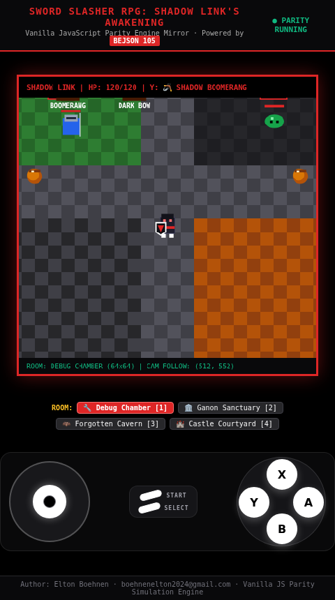
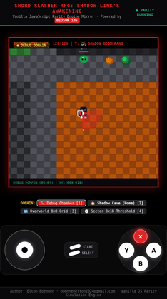
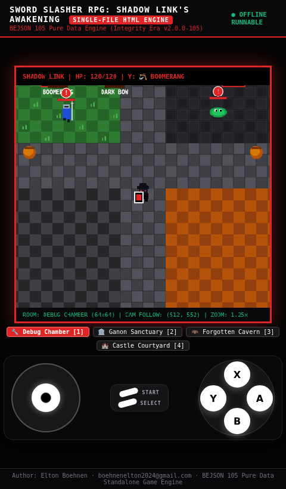
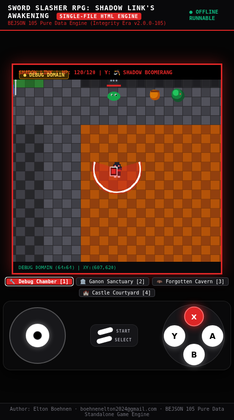
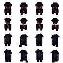

# Sword Slasher 2 — Shadow Link's Awakening (Prototype)

> **Project Status:** **Prototype**  
> Multi-runtime top-down 2D action-RPG simulation prototype built on decoupled **BEJSON 105 (`2.0.0-105`) Multi-File Database (MFDB)** tables.


---

## Author Intent

This prototype explores **pure-data separation of concerns** in a 2D action-RPG engine:

- **Engines are simulation runtimes only.** The TypeScript/React client (`src/`), Vanilla JavaScript parity engine (`Engines/JS/`), and single-file standalone HTML compiler (`Engines/Experimental/`) contain no hardcoded level layouts, enemy stats, item definitions, or sprite coordinates.
- **BEJSON is the single source of truth.** Every entity archetype, biome, tilemap chunk, item, audio frequency spec, sprite sheet, and combat registry lives in validated `.105.bejson` / `.105a.bejson` tables inside [`game_data/raw/`](game_data/raw/) (and mirrored to [`public/data/`](public/data/) for web clients).
- **Multi-runtime parity.** All engines read the exact same BEJSON datasets and execute identical physics, camera tracking, sword frame data, and standard NPC combat state machines.

---

## Visual Captures (Playwright Verified)

### Vanilla JS Parity Engine (`Engines/JS/`)
| Debug Chamber & Hyrule Forces | Full-Health Sword Beam & 4-Frame Slash |
|---|---|
|  |  |

### Experimental Single-File HTML Engine (`Engines/Experimental/Compiled/standalone-game.html`)
| 32x32 Cell-Sliced Sprites | 4-Frame Phased Sword Slash |
|---|---|
|  |  |

### Faction Sprite Sheets (1x `32x32` / `48x48` Grids)
| Shadow Link (`128x128`) | Hyrule Knight (`128x32`) | Hyrule Archer (`128x32`) | Hyrule Mage (`128x32`) |
|---|---|---|---|
|  |  |  |  |

---

## BEJSON 105 (`2.0.0-105`) Data Architecture

All game data adheres to the **Integrity Era BEJSON 105 (`Schema_Version: "2.0.0-105"`)** specification and is indexed by [`game_data/raw/manifest/105a.mfdb.bejson`](game_data/raw/manifest/105a.mfdb.bejson).

### Structural & Validation Rules
1. **Explicit Primary Key at `Fields[0]`**: Every table declares its UUID primary key as the first field (`spr_uuid`, `stat_uuid`, `item_uuid`, `anim_uuid`, `wpn_uuid`, `proj_uuid`, `imp_uuid`), ensuring `row.length === Fields.length` for every record.
2. **Envelope Metadata**: Tables declare `Format: "BEJSON"`, `Format_Version: "105" | "105a"`, `Format_Creator: "Elton Boehnen"`, `Schema_Version: "2.0.0-105"`, `Parent_Hierarchy`, `Write_Owner_Module`, `Primary_Key_Field`, `Type_Discriminator_Field`, and `Domain_Type_Field`.
3. **Field Map Cache Lookups**: [`bejsonCore`](src/lib/lib_bejson_Core_bejson_core.ts) builds a column-name-to-index map (`buildFieldMapCache`) with boundary whitespace sanitization. Positional integer array indexing is prohibited.
4. **Validation Gate**: `bejsonCore.validateDocument(doc)` enforces format headers, row-length parity (`E_BEJSON_RECORD_LENGTH_MISMATCH`), `required` non-null checks, and `enum` constraints.

### Dataset Inventory (`24` Raw BEJSON Tables)
- **Manifest & Schemas**: `manifest/105a.mfdb.bejson`, `schemas/schema_registry.105a.bejson`
- **World & Maps**: `biomes/biomes.105.bejson`, `levels/levels.105.bejson`, `chunks/cave_chunk_0_0.105.bejson`, `portals/portals.105.bejson`, `objects/objects.105.bejson`, `object_rules/object_rules.105.bejson`, `events/events.105.bejson`
- **Actors & Items**: `actors/actors.105.bejson`, `actor_stats/actor_stats.105.bejson`, `items/items.105.bejson`
- **Assets**: `sprites/sprites_manifest.105a.bejson`, `tiles/tiles_manifest.105a.bejson`, `audio/audio_manifest.105a.bejson`
- **Combat Registries**: `combat/shadow_link_combat_animations.105a.bejson`, `combat/weapons_combat_registry.105a.bejson`, `combat/projectile_combat_registry.105a.bejson`, `combat/projectile_impact_dynamics.105a.bejson`
- **Runtime Stores**: `runtime_physics/physics_world.105.bejson`, `runtime_assets/asset_cache.105a.bejson`, `runtime_events/event_bus_log.105.bejson`, `runtime_grid/grid_cells.105.bejson`, `runtime_telemetry/frame_telemetry.105.bejson`

---

## Combat & Engine Mechanics

### Standard NPC Combat AI (`lib_bejson_Gaming_npc_combat_ai`)
- **Two-Tiered State Machine**: Global status overrides (`STUNNED`, `HURT` / `IFRAMES`) intercept local behavioral loops (`PATROL -> ALERT -> RETREAT / LOCK_ON -> CHARGE / FIRE -> COOLDOWN`).
- **Staggered 1-in-4 Frame Rule**: Perception checks run on `((tickCount ^ slotIndex) & 3) === 0` to stagger line-of-sight evaluation across enemy slots.
- **Humanoid Linear Search Probes**: `guard`, `hyrule_knight`, `hyrule_archer`, and `hyrule_mage` cast a `176px` linear probe along their current cardinal `facing` axis (obstructed by bounds/props), allowing flanking behind their line of sight.
- **Directional Frontal Armor (`hyrule_knight`)**: Head-on melee hits opposite the knight's `facing` direction are deflected by its shield (unless stunned); side/rear flanks deal full damage.
- **Ranged Flankers (`hyrule_archer`, `hyrule_mage`)**: Retreat when the player closes within `88px`, align on a cardinal axis in `LOCK_ON`, and fire `enemy_arrow` or `enemy_bolt` projectiles.

### Sword Mechanics (`Engines/JS/main.js`, `src/components/GameViewport.tsx`, `Compile.py`)
- **13-Frame Slash Commitment**: Standard swings commit for `13` frames (`~216.7 ms` at 60 Hz) with zero post-swing recovery penalty.
- **4-Frame Phased Slash Visuals**: Renders wind-up, active strike, peak cleave with stepped crescent trail + afterimage, and follow-through.
- **Cardinal Handedness**: Clockwise sweep when facing `UP`, `DOWN`, or `LEFT`; mirrored counterclockwise sweep when facing `RIGHT`.
- **Sword-Hold Stance**: Holding the sword out locks cardinal facing (enabling strafing/backpedaling), applies a `0.833x` speed modifier, and projects an active poke hitbox (`12` damage).
- **Full-Health Sword Beam**: Swinging at maximum HP fires a `sword_beam` projectile along the active cardinal axis.

---

## Running & Building

### 1. React / TypeScript Client
```bash
npm install
npm run dev
```

### 2. Vanilla JS Parity Engine
Serve the repository root over HTTP (mapping `/assets/` and `/data/` to `public/`) and open `Engines/JS/index.html`.

### 3. Experimental Single-File HTML Compiler
Compiles all `24` raw BEJSON datasets into `Engines/Experimental/Compiled/standalone-game.html`:
```bash
cd Engines/Experimental/Compiler
python3 Compile.py
```

---

## Attribution & License

- **Author:** Elton Boehnen · boehnenelton2024@gmail.com · [boehnenelton2024.pages.dev](https://boehnenelton2024.pages.dev) · [github.com/boehnenelton](https://github.com/boehnenelton)
- **License:** **PolyForm Noncommercial License 1.0.0** (`PolyForm-Noncommercial-1.0.0`)
