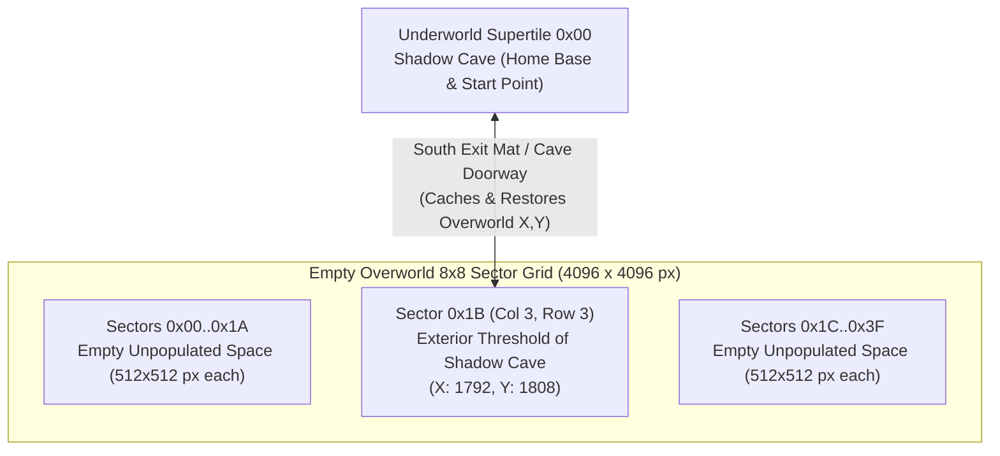

# Spatial World, Dual-Grid Underworld, Coordinate Math & Rendering Architecture Plan

- **Document**: `dev/world_map_architecture_plan.md`
- **Project**: `Shadow_Link_Awakening` (`PKG159+`)
- **Architecture**: BEJSON 105 MFDB / Multi-Engine Parity (React TypeScript, Vanilla JS, Experimental Single-File Compiler)
- **Date**: `2026-11-23`
- **Author**: Elton Boehnen · boehnenelton2024@gmail.com · boehnenelton2024.pages.dev · github.com/boehnenelton
- **License**: `PolyForm-Noncommercial-1.0.0`

---

## 1. Architectural Scope, Blank Canvas Policy & Home Base (`Shadow Cave`)

This specification defines the mathematical coordinate system, multi-tier tile hierarchy, overworld sector grid, shared-coordinate dual-realm overlay, supertile/subtile underworld grid, 3-layer occlusion pipeline, movement state table, and context-sensitive map projection for **Shadow Link's Awakening**.

1. **Zero Pre-Populated World Locations (Blank Spatial Canvas)**:
   - No pre-made towns, temples, forests, lakes, or external landmarks exist in the world data.
   - The `8 × 8` Overworld Grid (`64` sectors, `0x00`–`0x3F`, `4096 × 4096 px`) and the `16 × 16` Underworld Grid (`256` supertiles, `0x00`–`0xFF`) are initialized as **empty spatial containers** with clean coordinate math, camera clamps, and transition hooks ready for future world-building.
2. **Sole Active Campaign Location — `Shadow Cave` (`shadow_cave`)**:
   - **`[GAME WORLD 1] Shadow Cave`** is Shadow Link's **Home Base and Campaign Starting Point**.
   - **Indoor Binding**: Occupies Underworld Supertile `0x00` (and caches entry/exit coordinates via the Secondary/Home Return Anchor).
   - **Overworld Threshold**: Its south exit doorway opens directly onto the center of the empty `4096 × 4096 px` Overworld Canvas (`overworld_grid`, Sector `0x1B` at `Col 3, Row 3`, world coordinates $X = 1792, Y = 1808$). Stepping back into the threshold doorway on the Overworld returns Shadow Link inside `Shadow Cave`.
3. **Strict Debug Domain Isolation**:
   - **`[DEBUG DOMAIN]` (`debug_chamber`)**: Exists completely outside the campaign coordinate grid (`sector_id = 0xFF`, `supertile_id = 0xFFFF`). It is unreachable from `Shadow Cave` or the Overworld and can only be entered by opening the `SELECT` menu and flipping `DEBUG MODE: ON`.

---

## 2. Spatial Scale Hierarchy & Coordinate Bit-Shift Mathematics

The engine enforces power-of-two pixel dimensions across every tier so all spatial queries (metatile collision, megatile indexing, sector streaming, quadrant detection, and minimap projection) execute in $O(1)$ bit-shift arithmetic without floating-point division drift.

### 2.1 Multi-Tier Spatial Units

| Spatial Tier | Base Composition | Pixel Dimensions | Hex Span | Bit Shift (from px) | Total Capacity |
| :--- | :--- | :--- | :--- | :--- | :--- |
| **Sub-Tile (Atomic)** | `1 × 1` micro-unit | `8 × 8 px` | `0x08 × 0x08` | `>> 3` | `512 × 512` (`262,144` in Overworld) |
| **Gameplay Metatile** | `2 × 2` sub-tiles | `16 × 16 px` | `0x10 × 0x10` | `>> 4` | `256 × 256` (`65,536` in Overworld) |
| **Structural Megatile** | `2 × 2` metatiles | `32 × 32 px` | `0x20 × 0x20` | `>> 5` | `128 × 128` (`16,384` in Overworld) |
| **Indoor Quadrant** | `16 × 16` metatiles | `256 × 256 px` | `0x0100 × 0x0100` | `>> 8` | `4` per Underworld Supertile |
| **Standard Sector / Supertile** | `32 × 32` metatiles | `512 × 512 px` | `0x0200 × 0x0200` | `>> 9` | `64` Overworld Sectors / `256` Supertiles |
| **2×2 Linked Mega-Sector** | `64 × 64` metatiles | `1024 × 1024 px` | `0x0400 × 0x0400` | `>> 10` | Dynamic multi-sector union |
| **Full Overworld Canvas** | `256 × 256` metatiles | `4096 × 4096 px` | `0x1000 × 0x1000` | `>> 12` | `16,777,216 px²` (`8 × 8` Sectors) |

### 2.2 Core Coordinate Conversion Equations

Given Shadow Link's continuous 16-bit position $(X, Y, Z)$ where $X, Y \in [0, 4095]$ (`0x0000`–`0x0FFF`) and $Z \in [0, 255]$ represents vertical elevation above the floor:

```text
Global Metatile Index:      tile_x = X >> 4                  tile_y = Y >> 4
Global Megatile Index:      mega_x = X >> 5                  mega_y = Y >> 5
Overworld Sector Grid:      sec_col = (X >> 9) & 0x07        sec_row = (Y >> 9) & 0x07
Overworld Sector ID:        sector_id = (sec_row << 3) | sec_col          // 0x00..0x3F (0..63)
Sector-Local Pixel Offset:  local_px = X & 0x01FF            local_py = Y & 0x01FF
Sector-Local Metatile:      local_tx = (X & 0x01FF) >> 4     local_ty = (Y & 0x01FF) >> 4
Local 1D Array Index:       cell_idx = (local_ty << 5) | local_tx         // 0..1023 (32x32 grid)
```

---

## 3. Overworld 8×8 Empty Sector Grid, Multi-Sector Linking & Camera Clamps

### 3.1 Blank 8×8 Sector Grid & Multi-Sector Linking Architecture

The Overworld is partitioned into **64 discrete `512 × 512 px` sectors** (`0x00`–`0x3F` on an `8 × 8` grid). By default, all 64 sectors are initialized as open, unpopulated terrain slots (`EMPTY_SECTOR_SLOT`), with Sector `0x1B` (`Col 3, Row 3`, pixel bounds $X \in [1536, 2047], \ Y \in [1536, 2047]$) hosting the exterior threshold of **`Shadow Cave`**.



Adjacent sectors can be dynamically linked into contiguous **Multi-Sector Regions** (`1×1`, `2×1`, `1×2`, or `2×2` sectors) via three metadata fields on each sector record:
- `sec_root_sector_id`: Top-left anchor sector ID (`0x00..0x3F`) of the linked group (defaults to `sector_id` for unlinked `1×1` sectors).
- `sec_span_cols`: Horizontal sector span (`1..8`).
- `sec_span_rows`: Vertical sector span (`1..8`).

### 3.2 Dynamic Camera Scroll Clamp Math (`$0600` Equivalent)

For any active sector belonging to `sec_root_sector_id`, the camera scroll boundaries clamp to the outer perimeter of the linked sector group:

$$\text{root\_col} = \text{sec\_root\_sector\_id} \ \& \ \text{0x07}, \quad \text{root\_row} = (\text{sec\_root\_sector\_id} \gg 3) \ \& \ \text{0x07}$$

$$\text{region\_min\_x} = \text{root\_col} \times 512, \quad \text{region\_min\_y} = \text{root\_row} \times 512$$

$$\text{region\_max\_x} = (\text{root\_col} + \text{sec\_span\_cols}) \times 512$$

$$\text{region\_max\_y} = (\text{root\_row} + \text{sec\_span\_rows}) \times 512$$

For a logical viewport of width $V_w$ and height $V_h$:

$$\text{camera\_x} = \max\left(\text{region\_min\_x}, \ \min\left(X - \frac{V_w}{2}, \ \text{region\_max\_x} - V_w\right)\right)$$

$$\text{camera\_y} = \max\left(\text{region\_min\_y}, \ \min\left(Y - \frac{V_h}{2}, \ \text{region\_max\_y} - V_h\right)\right)$$

### 3.3 Intra-Region vs. Inter-Region Boundary Crossing

1. **Intra-Region Crossing (`next_sec.sec_root_sector_id === curr_sec.sec_root_sector_id`)**:
   - Seamless scrolling with zero pause. `active_sector_id` updates in place as $(X, Y)$ crosses the `512 px` grid line.
2. **Inter-Region Crossing (`next_sec.sec_root_sector_id !== curr_sec.sec_root_sector_id`)**:
   - Triggered when the player's collision AABB crosses `region_min_x`, `region_max_x`, `region_min_y`, or `region_max_y` while in `LNMOVE_WALK` or `SWMOVE_SWIM`.
   - Enters `ENGINE_STATE_SECTOR_TRANSITION` for `24` frames:
     1. Pauses actor AI and ancilla timers.
     2. Linearly interpolates camera from the old clamp edge to the new sector's clamp edge while translating the player `16 px` across the border.
     3. Clears transient projectiles/drops, updates `$0600` camera clamps, and sets `BIT_VISITED` on the new sector in `RoomPersistenceFlags`.

---

## 4. Dual-Realm Shared-Coordinate Overlay Architecture

To support a secondary dimension (**Eclipse Rift Overworld**, `realm_id = 1`) over the **Base Overworld** (`realm_id = 0`) without duplicating 64 sector matrices, the second realm is architected as a **Delta Overlay**:

1. **Shared `[0, 4095] × [0, 4095]` Coordinate Grid**: Both realms share the exact same `8 × 8` sector IDs (`0x00`–`0x3F`) and pixel coordinates.
2. **Sparse Delta Resolution**: When `realm_id === 1`, the engine reads the Base Sector terrain matrix, applies the Rift palette transform, and applies sparse metatile/collision overrides from `sec_rift_delta_override_json`.
3. **Phase-Shift Coordinate Projection & Solid-Tile Rebound**:
   - Activating a Phase-Shift at $(X, Y, Z)$ in `realm_id = 1` projects the player to $(X, Y, Z)$ in `realm_id = 0` and records a return anchor at $(X, Y)$.
   - If the destination tile at `(X >> 4, Y >> 4)` in the target realm has solid collision (`collision_mask !== 0`), the engine triggers a rebound effect and ejects the player back to the origin realm at $(X, Y)$.

---

## 5. Dual-Grid Underworld Architecture (Supertiles, Quadrants & Secondary Interiors)

Indoors is decoupled from the Overworld `8 × 8` grid into two indoor subsystems:

### 5.1 System A: Primary Underworld Grid (`16 × 16 = 256` Supertiles, `0x00`–`0xFF`)

1. **Supertile Grid Math**:
   - `256` Supertile slots (`0x00`–`0xFF`) arranged on a `16 × 16` matrix. Each supertile measures `512 × 512 px` (`32 × 32` metatiles).
   - **Supertile `0x00` is assigned to `Shadow Cave` (Home Base & Starting Point)**. Supertiles `0x01`–`0xFF` are initialized as empty underworld slots ready for future dungeons and multi-exit caverns.
   - Grid coordinates and cardinal transitions:
     $$\text{st\_col} = \text{supertile\_id} \ \& \ \text{0x0F}, \quad \text{st\_row} = (\text{supertile\_id} \gg 4) \ \& \ \text{0x0F}$$
     - **North**: `(supertile_id - 0x10) & 0xFF`
     - **South**: `(supertile_id + 0x10) & 0xFF`
     - **West**: `(supertile_id - 0x01) & 0xFF`
     - **East**: `(supertile_id + 0x01) & 0xFF`
2. **Internal 4-Quadrant Subdivision (`NW, NE, SW, SE`)**:
   - Every `512 × 512 px` supertile subdivides into four `256 × 256 px` (`16 × 16` metatile) Quadrants:
     $$\text{quadrant\_id} = ((ly \gg 8) \ll 1) \ | \ (lx \gg 8) \quad \in \{0 \ (\text{NW}), \ 1 \ (\text{NE}), \ 2 \ (\text{SW}), \ 3 \ (\text{SE})\}$$
3. **Subtile Partition Layouts & Camera Clamps**:
   - `FULL_4Q`: All 4 quadrants form one `512 × 512 px` room (`Shadow Cave` default layout).
   - `SPLIT_V_2X2Q`: Two `256 × 512 px` vertical rooms (`{NW, SW}` and `{NE, SE}`).
   - `SPLIT_H_2X2Q`: Two `512 × 256 px` horizontal rooms (`{NW, NE}` and `{SW, SE}`).
   - `QUAD_4X1Q`: Four independent `256 × 256 px` single-quadrant rooms.
4. **Subtile vs. Supertile Transition Persistence**:
   - **Intra-Supertile (Subtile Transition)**: Crossing between subtiles within the same `supertile_id` updates the active quadrant camera clamps (`$0600`) **without** resetting active sprites, enemies, or dropped items.
   - **Inter-Supertile (Supertile Transition)**: Crossing into a different `supertile_id` flushes transient actors/ancillae, clears the transient `TileMutationBuffer`, and loads the new supertile's state.
5. **Door Taxonomy & Pitfall Target (`st_pit_target_supertile_id`)**:
   - Supports `DOOR_OPEN`, `DOOR_SMALL_KEY`, `DOOR_BIG_KEY`, `DOOR_SHUTTER_ENEMY`, `DOOR_SHUTTER_SWITCH`, `DOOR_BOMBABLE_WALL`, and `DOOR_ONE_WAY`.
   - Every supertile header defines `st_pit_target_supertile_id` (`0x00..0xFF` or `null`) to support deterministic floor drops when falling into pits.

### 5.2 System B: Secondary Interior Table (`40` Single-Exit Rooms, `0x100`–`0x127`) & Return Caching

- Provisioned for single-exit interiors (`0x100`–`0x127`).
- **Overworld Return Coordinate Cache (`overworldReturnAnchor`)**:
  - Whenever Shadow Link enters a single-exit interior (or enters `Shadow Cave` from the Overworld threshold), the engine caches:
    ```ts
    overworldReturnAnchor = {
      realmId: activeRealmId,
      sectorId: activeSectorId,
      worldX: playerWorldX,
      worldY: playerWorldY + 16,
      facing: 'DOWN'
    };
    ```
  - Stepping onto the interior's south exit mat restores Shadow Link directly to `overworldReturnAnchor` on the Overworld canvas (defaulting to Sector `0x1B`, $X = 1792, Y = 1808$ outside `Shadow Cave` when exiting at game start).

---

## 6. 3-Layer Compositing (`BG1 / BG2 / BG3`), Bridge Occlusion & `TileMutationBuffer`

### 6.1 Three-Layer Rendering & Priority Occlusion

1. **`BG1` (Base Terrain Layer)**: Ground tiles, walls, deep water, pit voids, and stair triggers.
2. **`BG2` (Overhead Overlay & Bridge Layer)**:
   - Carries `priority_bit (0 | 1)` and `elevationLayer (0 | 1)`.
   - When `player.elevationLayer === 0`, `BG2` tiles with `priority_bit === 1` render **above** the player sprite (occluding Shadow Link under arches or bridges).
   - When `player.elevationLayer === 1` (toggled via stair tiles), the player renders **above** `BG2` and collides against upper bridge boundaries.
3. **`BG3` (HUD & Sub-Screen Layer)**: Fixed viewport overlay for hearts, active item box, dialogue, and the `X`-button map.

### 6.2 `TileMutationBuffer` (`$05A0` Equivalent) & `RoomPersistenceFlags`

1. **`TileMutationBuffer`**: Runtime $O(1)$ map (`Map<cellIdx, replacementTileId>`) recording dynamic tile modifications (cut bushes, lifted pots, bombed walls, opened chests) and zeroing the local collision bitmask without mutating static BEJSON files.
2. **`RoomPersistenceFlags` (`Uint32Array[320]`)**:
   - Indices `0..255`: Underworld Supertiles `0x00..0xFF`.
   - Indices `256..319`: Overworld Sectors `0x00..0x3F`.
   - Tracks permanent bitflags per room/sector: unlocked doors (`bits 0..3`), bombed walls (`bits 4..7`), opened chests (`bits 8..13`), boss cleared (`bit 14`), and visited state (`bit 15`).

---

## 7. Player Movement State Machine (`PLMVTBL` Equivalent) & Elevation (`Z`)

Movement is governed by a 7-state dispatch table (`PlayerMovementStateMachine`):

| State Code | Mode Identifier | Kinematic & Collision Behavior |
| :--- | :--- | :--- |
| **`0x00`** | `LNMOVE_WALK` | Standard 8-way ground walking (`2.5 px/frame`) with `4 px` corner-chamfer sliding and boundary/portal triggers. |
| **`0x01`** | `SWMOVE_SWIM` | Deep-water swimming (`1.8 px/frame`); requires `flippers_unlocked` flag (else rebounds to shallow water/shore). |
| **`0x02`** | `JUMPMV_LEDGE` | One-way ledge hop; disables solid tile collision mid-air; **clamps $(X, Y)$ within active region bounds** to prevent screen-wrap desync; parabolic elevation arc $Z(t) = 12 \sin(\pi t / 18)$. |
| **`0x03`** | `DASHMV_BOOTS` | Axis-locked sprint (`5.5 px/frame`); wall impact triggers `14`-frame `RECOIL` state with screen shake. |
| **`0x04`** | `HLDEMO_PITFALL` | Pitfall pull toward tile center (`20` frames, sprite scale `1.0 -> 0.15`); warps to `st_pit_target_supertile_id` if set, else deducts `20 HP` and respawns at `lastSafeEntryXY`. |
| **`0x05`** | `BGISMV_CARRY` | Lifts interactive metatile (`TileMutationBuffer`), attaches sprite to `(X, Y - 14 - Z)`, and throws on `A` press. |
| **`0x06`** | `ITMHKM_GRAPPLE` | Linearly pulls player (`7.0 px/frame`) along grapple vector to target anchor metatile while suspending pit/water checks. |

---

## 8. Context-Sensitive Interactive Map System (`X` Button)

Pressing **`X`** switches view modes based on whether Shadow Link is indoors (`UNDERWORLD`) or outdoors (`OVERWORLD`):

1. **Outdoors (`X` -> Overworld 8×8 Field Map)**:
   - Renders the `1024 × 1024 px` virtual map (`1:4` downscale of the `4096 × 4096 px` Overworld, $M_x = X \gg 2, \ M_y = Y \gg 2$).
   - Displays the `8 × 8` sector grid (`0x00`–`0x3F`), highlighting visited sectors (`BIT_VISITED`) and marking **`Shadow Cave` (Home Base)** at Sector `0x1B` (`Col 3, Row 3`).
   - Supports **Perspective Overview Mode** (affine tilted full-grid view) and **Regional Zoom Mode** (`2×` magnified focus around active sector).
   - Projects Shadow Link's blinking position cursor into screen space $(S_x, S_y)$ as an un-distorted overlay marker.
2. **Indoors (`X` -> Underworld / Dungeon Supertile Map)**:
   - Displays the `16 × 16` Underworld Supertile grid and floor selector (`B2..3F`).
   - Highlights Supertile `0x00` (**`Shadow Cave` Home Base**) and its 4 internal quadrants (`NW, NE, SW, SE`), showing Shadow Link's exact live quadrant position and exit connector.

---

## 9. Phased Execution Roadmap (Blank Canvas + `Shadow Cave` Foundation)

> **Target Engines**: React TypeScript (`src/`), Vanilla JS (`Engines/JS/`), Experimental Standalone (`Engines/Experimental/Compiler/Compile.py`)
> **Active Campaign Locations**: Strictly **`Shadow Cave` (`shadow_cave`, Home Base & Start Point)** + **Empty Overworld 8×8 Grid (`overworld_grid`)** + isolated **`[DEBUG DOMAIN]` (`debug_chamber`)**.

### Phase 1: Clean BEJSON 105 Datasets (`Shadow Cave` + Empty `8×8` Overworld)
- [ ] **1.1** Update `game_data/raw/levels/levels.105.bejson` and `public/data/levels/levels.105.bejson` to remove old placeholder rooms and define strictly:
  1. `shadow_cave` (`[GAME WORLD 1] Shadow Cave` — Home Base & Start Point, Supertile `0x00`, `512 × 512 px`).
  2. `overworld_grid` (`[GAME WORLD 1] Overworld 8x8 Sector Grid` — Empty `4096 × 4096 px` world canvas with `Shadow Cave` exterior threshold at Sector `0x1B`).
  3. `debug_chamber` (`[DEBUG DOMAIN] Item & Feature Test Chamber` — Isolated behind `SELECT` menu Debug Switch).
  - *Verify*: `python3 -c "import json; json.load(open('game_data/raw/levels/levels.105.bejson'))"` (Exit Code 0).
- [ ] **1.2** Update `game_data/raw/portals/portals.105.bejson` and `public/data/portals/portals.105.bejson` to link `shadow_cave` (south exit mat) $\leftrightarrow$ `overworld_grid` (Sector `0x1B` threshold at $X = 1792, Y = 1808$).
  - *Verify*: Validate JSON structure in both `game_data/raw/` and `public/data/`.

### Phase 2: Spatial World, Coordinate Math & Underworld Supertile Engine
- [ ] **2.1** Create `src/lib/lib_js/lib_bejson_Gaming_spatial_world_engine.js` and `src/lib/lib_bejson_Gaming_spatial_world_engine.ts` implementing:
  - $O(1)$ bit-shift coordinate math (`>> 3`, `>> 4`, `>> 5`, `>> 8`, `>> 9`).
  - `8 × 8` empty Overworld Sector Grid (`0x00`–`0x3F`), multi-sector linking, dynamic `$0600` camera scroll clamps, and 24-frame sector transitions.
  - Dual-Realm shared-coordinate delta overlay & Phase-Shift solid-tile rebound.
  - `16 × 16` Underworld Supertile Grid (`0x00`–`0xFF`, with `0x00 = Shadow Cave`), 4-Quadrant (`NW, NE, SW, SE`) subdivision, subtile persistence rules, `overworldReturnAnchor` caching, `TileMutationBuffer`, `RoomPersistenceFlags`, and the 7-state `PlayerMovementStateMachine` (`PLMVTBL`).
  - *Verify*: `node --check src/lib/lib_js/lib_bejson_Gaming_spatial_world_engine.js` (Exit Code 0).

### Phase 3: Cross-Engine Integration (React, Vanilla JS & Experimental Compiler)
- [ ] **3.1** Wire `shadow_cave` as the default campaign starting point and integrate the empty `8 × 8` `overworld_grid` transitions, 3-layer `BG1/BG2/BG3` priority occlusion, and `X`-button context-sensitive Overworld/Underworld Map across React (`src/App.tsx`, `src/components/GameViewport.tsx`, `src/components/WorldMapOverlay.tsx`, `src/engine/bejsonEngine.ts`).
  - *Verify*: Build React app (`npm run build`) with 0 errors.
- [ ] **3.2** Synchronize `Engines/JS/main.js`, `Engines/JS/index.html`, and `Engines/Experimental/Compiler/Compile.py` so Vanilla JS and Experimental Standalone boot in `Shadow Cave`, transition seamlessly to the empty `4096 × 4096 px` Overworld Sector Grid (`0x00`–`0x3F`), and render the `X`-button Overworld/Supertile map.
  - *Verify*: `node --check Engines/JS/main.js` and `python3 Engines/Experimental/Compiler/Compile.py --compile` (Exit Code 0).

### Phase 4: Verification & Package Delivery
- [ ] **4.1** Run headless Chromium Playwright tests (`dev/test_engines_playwright.py`) verifying `Shadow Cave` home base boot, exit transition to empty Overworld Sector `0x1B`, sector coordinate tracking, and `SELECT` Debug Mode Switch isolation.
  - *Verify*: `python3 dev/test_engines_playwright.py` (0 browser errors).
